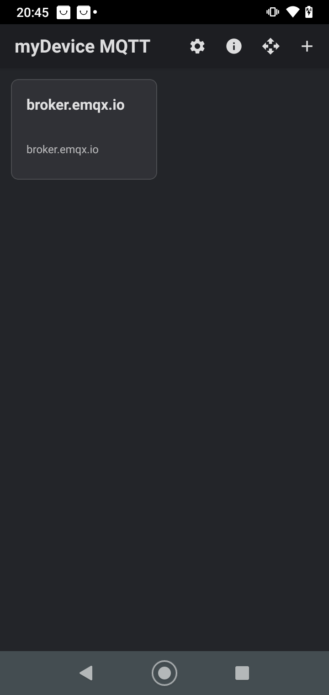
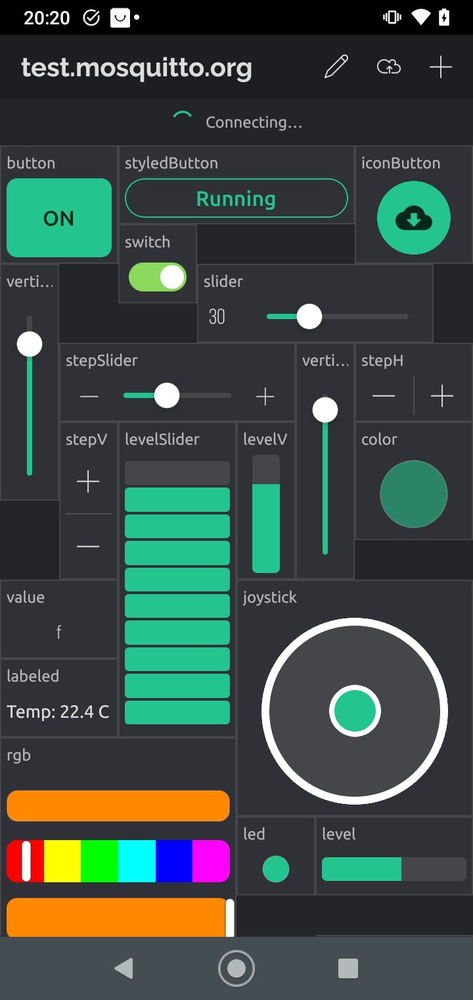
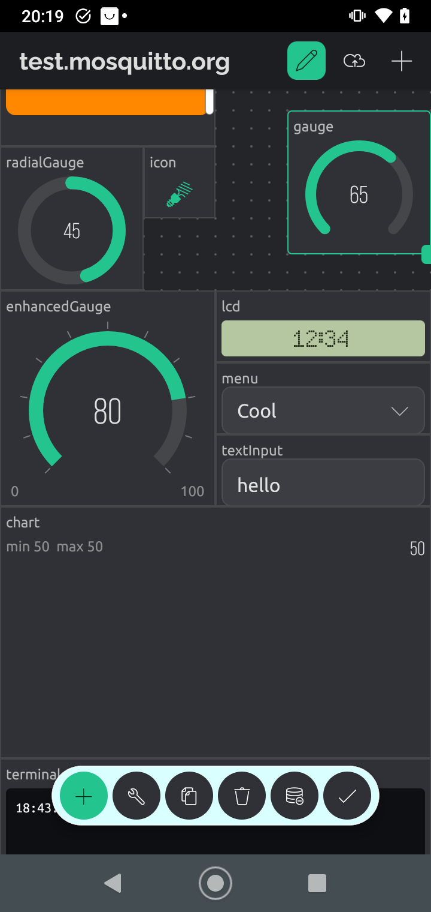
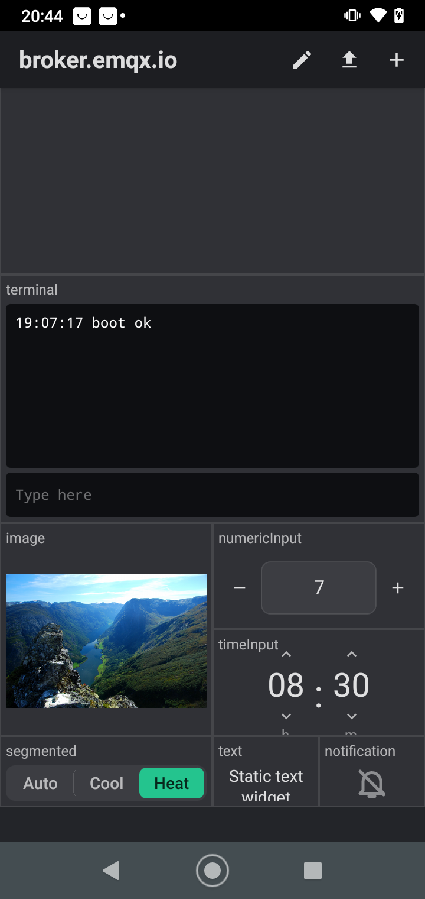
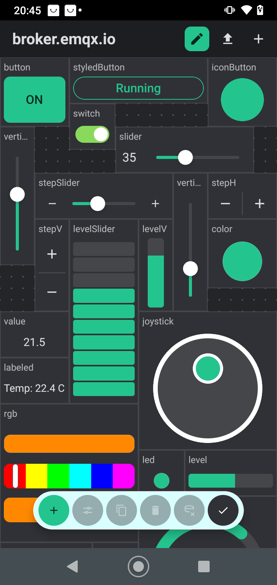
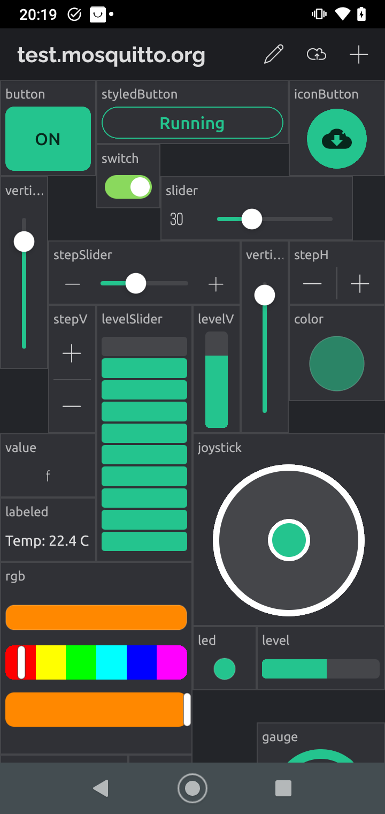
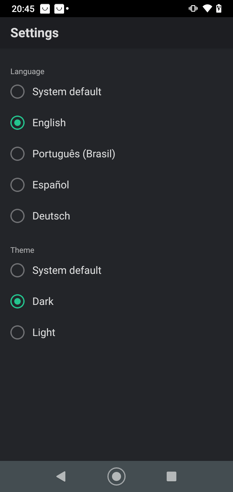
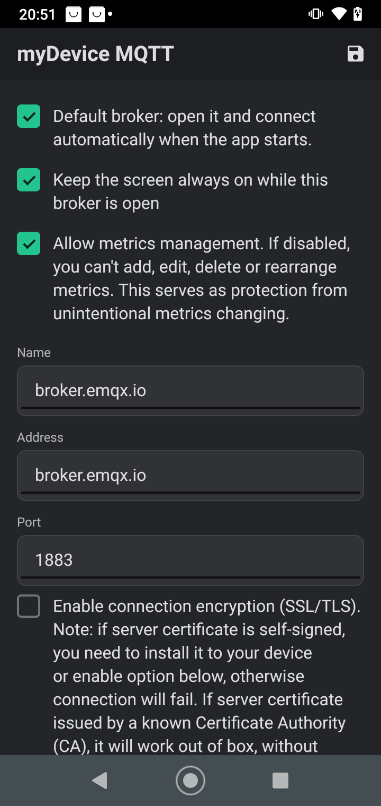
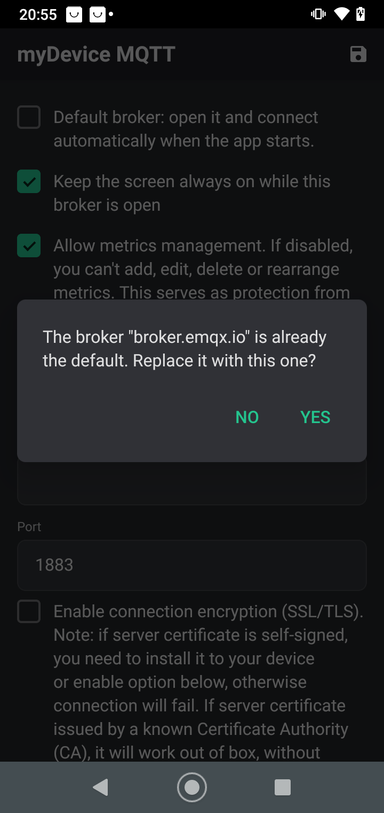

# myDevice MQTT

A React Native + TypeScript MQTT client and dashboard for Android: several brokers, and tiles added on demand.

## What it does

- Several MQTT brokers (endpoints): plain TCP, TLS (optionally trusting self-signed certificates), or WebSocket when the
  address is a `ws://` / `wss://` URL. User/password, client id, keep-alive 30 s. Per broker: *Default* (opened and connected automatically when the app starts; only one broker can be the default: marking another one asks, naming the current default, before replacing it) and *Keep the screen always on* while its dashboard is open. A lost connection shows a "Connection lost. Reconnecting…" banner, is retried every 5 s and is retried at once when the app returns to the foreground.
- Dashboards with tiles added on demand: **Text, Switch/button, Range/progress, Multi choice, Image, Color**, each with
  options such as JSON path, QoS, retained, separate publish topic, intermediate state, blink expression,
  On Receive / On Display / On Tap JavaScript hooks).
- Import / export of tiles over an MQTT topic, as JSON.
- A built-in set of line icons for tiles and widgets.

Also included:

- **Notification tile**: every message on its topic raises a *local* Android notification.
- **Background operation**: while a notification tile exists the app keeps its own MQTT connection in a foreground
  service, so notifications arrive with the app in the background. No Firebase, FCM or push token anywhere.
- A default broker (`broker.emqx.io:1883`) on first run.
- **Widget UI**: 35 widgets on a 24-column grid, each bound to MQTT topics: Button, Styled Button, Icon Button, Switch,
  Slider, Vertical Slider, Step Slider (both), Step H/V, Level Slider, Joystick, zeRGBa, Color Picker, Value Display,
  Labeled Value, LED, Gauge, Radial and Enhanced Gauge, LCD, SimpleChart, Terminal, Level H/V, Image, Icon, Menu, Text /
  Numeric / Time Input, Segmented Switch, Text, Dynamic Spacer and Notification. Edit mode (pencil) shows the grid, a tap
  selects a widget, dragging moves it, the corner handle resizes it, and a toolbox adds, edits, duplicates and deletes.
  The Widget Box lists them as Controllers, Displays, Interface and Other.
  Rectangles are stored as optional `gx/gy/gw/gh` and per-widget settings in `opts`; tiles saved by older versions are
  placed automatically.
- **Languages and themes**: English, Portuguese (Brazil), Spanish and German, with a dark and a light theme. The gear
  icon in the top bar of the main screen opens Settings, where the language and the theme are chosen (or left on
  "System default"). Changes apply at once and are remembered. Texts live in `src/i18n`; user data such as widget
  names, topics and payloads is never translated.
- Widgets that need cloud services or extra SDKs (maps, video, music player, reports, automations) are not included.
- **Color palette** (10-step ramps) in the tile color dialog.

## Screenshots

Moto G7 Power, release build, dark theme, demo dashboard with one widget of every kind (`tools/publish-demo.ts widgets`).

| Devices | Dashboard | Dashboard (scrolled) |
|---|---|---|
|  |  |  |

| Terminal, image, inputs | Edit mode | Widget Box |
|---|---|---|
|  |  |  |

| Settings | Broker settings | Replace the default broker |
|---|---|---|
|  |  |  |

## Widgets

Every widget is bound to MQTT topics (subscribe topic, optional publish topic, QoS, retained, JSON path and the
On Receive / On Display / On Tap script hooks all work as on the other tiles). Settings specific to a widget are in its
form; sizes are in cells of the 24-column grid (default size shown).

### Controllers

| Widget | What it does | Publishes |
|---|---|---|
| Button (6x6) | Solid button showing ON / OFF; tap toggles. | on / off payload |
| Styled Button (12x4) | Button with a style (solid, outlined, solid + stroke, text), a shape (pill, rounded, sharp) and custom ON / OFF labels. | on / off payload |
| Icon Button (6x6) | Round button with the metric's icon, filled while on. | on / off payload |
| Switch (4x4) | On / off toggle. | on / off payload |
| Slider (12x4) | Horizontal slider with the value on the left. | value, on release |
| Vertical Slider (3x12) | Vertical slider. | value, on release |
| Step Slider (12x4) | Slider that snaps to a step, with - / + buttons. | value |
| Vertical Step Slider (3x12) | Vertical slider snapping to a step. | value, on release |
| Step H / Step V (6x4 / 3x8) | Two buttons that add or subtract a step, optionally looping at the limits. | value |
| Level Slider (6x16) | Vertical bar of segments; tap or drag to set the level. | value, on release |
| Joystick (12x12) | Round pad; auto-returns to the center. | `x,y` scaled to min..max, throttled |
| zeRGBa (12x12) | Hue and brightness bars with a preview. | `#RRGGBB` (or the integer), on release |
| Color Picker (6x6) | Color swatch; tap opens the color dialog. | `#RRGGBB` or integer |

### Displays

| Widget | What it shows |
|---|---|
| Value Display (6x4) | The payload, auto-sized. |
| Labeled Value (6x4) | The payload with the tile's prefix and postfix (for example `Temp: 22.4 C`). |
| LED (4x4) | A dot lit while the switch payload matches. |
| Gauge (12x12) | 270 degree arc with the value in the middle. |
| Radial Gauge (8x8) | Full ring with the value (optional label). |
| Enhanced Gauge (12x12) | Arc with tick marks and min / max labels. |
| LCD (12x4) | Payload on an LCD-style panel. |
| SimpleChart (24x14) | Line chart of the numbers received while the dashboard is open (last 200), with min, max and the latest value. |
| Terminal (24x14) | Received lines (optional timestamps) and an input line that publishes what you type. |
| Level H / Level V | Horizontal or vertical bar filled by the value. |
| Image (12x12) | Image from a URL (refreshed) or from the payload. |
| Icon (4x4) | Icon that follows the on / off state. |

### Interface and other

| Widget | What it does |
|---|---|
| Menu (12x4) | Drop-down of options (label and payload); publishes the chosen payload. |
| Segmented Switch (12x4) | Row of options with the current one highlighted. |
| Text Input (12x4) | Text field; the send key publishes the text. |
| Numeric Input (12x6) | Number field with - / + buttons, step, min, max and loop. |
| Time Input (12x6) | Hour and minute steppers publishing `HH:MM`. |
| Text (6x4) | Static text set in the widget's settings (or the live payload when empty). |
| Dynamic Spacer (24x2) | Invisible gap; outlined while editing. |
| Notification (6x4) | Raises a local Android notification for every message (works in the background). |

### Publish and subscribe examples

Each widget has a **Topic** (what it subscribes to) and an optional **Topic (pub)** (where it publishes; empty means it
publishes to the same topic). Seen from the broker, **sub** is what the widget receives, so you drive it with
`mosquitto_pub`, and **pub** is what the widget sends when you act on it, so you watch it with `mosquitto_sub`. The
examples use the topic `mqttiot/widgets/<kind>` (the layout of the demo dashboard) on `broker.emqx.io`:

```sh
# watch everything the dashboard receives or publishes
mosquitto_sub -h broker.emqx.io -t 'mqttiot/widgets/#' -v
# drive a widget: a Slider (0..100) moves to 35
mosquitto_pub -h broker.emqx.io -t mqttiot/widgets/slider -m 35
```

In the tables, "Drive" is the payload you publish to the widget's topic and "Sends" is what the widget publishes, always as
a plain string. Defaults: switch payloads `1` (on) and `0` (off), range `0`..`100`, precision `0` decimals.
"Min / max / precision" below are the tile's own settings; "opts" are the widget-specific options in its form.

Common rules:

- **Retained and QoS.** A widget publishes with the tile's *Retained* flag and QoS (0 or 1; a stored 2 is sent as 1).
  With *Retained* on, the broker keeps the last payload and a freshly connected dashboard shows it at once, for example
  `mosquitto_pub -h broker.emqx.io -t mqttiot/widgets/slider -m 35 -r -q 1`. Clear it with an empty retained message
  (`-r -n`) or with the toolbox's "delete retained message".
- **Publishing off.** With *Enable publishing* off, a controller still moves locally but sends nothing.
- **Own echo.** By default the widget shows what it published (the update-last-payload-on-publish setting), so it moves even if the
  broker never echoes the message back.
- **Switch payloads.** Switch based widgets (Button, Switch, LED, Icon, ...) react only to a payload equal to their *On* or
  *Off* payload; anything else is ignored.

#### Controllers

| Widget | Settings that matter | Drive (publish to the topic) | Sends (on action) |
|---|---|---|---|
| Button | On / Off payload | `1` shows ON (lit), `0` shows OFF | Tap toggles: `0` when on, else `1` |
| Styled Button | opts: style (solid, outlined, solidStroke, text), edge (pill, rounded, sharp), labelOn, labelOff | `1` shows the *labelOn* text, `0` the *labelOff* text | Tap toggles, same as Button |
| Icon Button | On / Off payload, On / Off icon and color | `1` fills the round button, `0` empties it | Tap toggles, same as Button |
| Switch | On / Off payload (for example `ON` / `OFF`) | `ON` turns the knob on, `OFF` off | Tap sends the opposite payload (`OFF` while on, else `ON`) |
| Slider | Min / max, precision, prefix / postfix | `35` moves the thumb to 35% of the range | Drag, sent on release: the value formatted with the precision (`35`; with precision 1: `35.0`) |
| Vertical Slider | Same as Slider | `60` raises the thumb to 60 | On release, same as Slider |
| Step Slider | Min / max, precision, opts: step (default 1) | `40` | - / + buttons send value -/+ step at once (`50`); a drag snaps to the step and sends on release |
| Vertical Step Slider | Min / max, precision, opts: step (default 1) | `30` | On release, the value snapped to the step (for example `30`, `40`) |
| Step H / Step V | Min / max, precision, opts: step (default 1), loop (default off) | `25` sets the current value the next - / + press starts from | - or + sends value -/+ step; past a limit it stays at the limit, or wraps to the other end with loop (`100` + 5 gives `0`) |
| Level Slider | Min / max, precision, opts: segments (default 10, min 2) | `70` lights 7 of 10 segments (`round(ratio * segments)`) | Tap or drag, sent on release: the value (`70`) |
| Joystick | opts: min (default 0), max (default 255), autoreturn (default on) | `128,200` puts the handle at x 128, y 200 (x to the right, y up); anything that is not `x,y` centers it | `x,y` as integers scaled to min..max, e.g. `255,128`; sent on touch, throttled to 10 per second while moving, and on release the center `128,128` (when autoreturn is on) |
| zeRGBa | Color format: hex (default) or integer | `#FF8800` (or `16746496` with integer format) sets hue and brightness | Hue and brightness bars, sent on release: `#FF8800` (hex) or `16746496` (integer format) |
| Color Picker | Color format: hex (default) or integer | `#24C48E` or `2409614` shows the swatch; an invalid text shows "Invalid color format" | Tap opens the color dialog; OK sends `#RRGGBB` uppercase (hex) or the RGB integer |

Examples:

```sh
mosquitto_pub -h broker.emqx.io -t mqttiot/widgets/switch  -m ON          # Switch on, with payloads ON / OFF
mosquitto_pub -h broker.emqx.io -t mqttiot/widgets/stepH   -m 25          # Step H now at 25; tap + and you see 30 on the topic
mosquitto_pub -h broker.emqx.io -t mqttiot/widgets/joystick -m 128,200
mosquitto_pub -h broker.emqx.io -t mqttiot/widgets/rgb     -m '#FF8800'
```

#### Displays

Displays only subscribe, except where the Sends column says otherwise.

| Widget | Settings that matter | Drive (publish to the topic) | Sends |
|---|---|---|---|
| Value Display | Prefix / postfix, text size | `21.5` shows 21.5 | Tap opens a text dialog; OK sends the typed text |
| Labeled Value | Prefix `Temp: `, postfix ` C` | `22.4` shows `Temp: 22.4 C` | Tap opens a text dialog, as Value Display |
| LED | On / Off payload | `1` lights the dot, `0` dims it | Nothing |
| Gauge | Min / max, precision, prefix / postfix, "Display payload value instead of percentage" | `65` fills 65% of the 270 degree arc; the center shows `65` (or the percentage when that option is off) | Nothing |
| Radial Gauge | Same as Gauge, opts: showLabel (default on) | `45` fills 45% of the ring | Nothing |
| Enhanced Gauge | Same as Gauge | `80` fills 80% of the arc; min and max are printed under it | Nothing |
| LCD | Prefix / postfix | `12:34` shows `12:34` on the LCD panel | Nothing |
| SimpleChart | opts: line width (default 2) | `50`, then `55`, `48`: each number adds a point (last 200 while the dashboard is open); non numeric payloads are skipped | Nothing |
| Terminal | opts: timestamps, newline | `boot ok` appends a line (with the time when timestamps is on) | A line typed and sent with the keyboard's send key: `reboot` (plus `\n` when newline is on); empty input is not sent |
| Level H / Level V | Min / max | `55` fills 55% of the bar | Nothing |
| Image | Kind: URL, URL in payload, data in payload; reload interval | Kind "URL in payload": `https://www.gstatic.com/webp/gallery/1.png`; kind "data in payload": the raw image bytes (for example `mosquitto_pub -h broker.emqx.io -t mqttiot/widgets/image -f photo.png`); kind "URL": payloads are ignored and the fixed URL reloads every interval | Nothing (tap opens the image, or the tile's open URL) |
| Icon | On / Off payload, On / Off icon and color | `1` shows the on icon (colored), `0` the off icon | Nothing |

#### Interface and other

| Widget | Settings that matter | Drive (publish to the topic) | Sends (on action) |
|---|---|---|---|
| Menu | Items (label and payload), e.g. `Auto`=`a`, `Cool`=`c`, `Heat`=`h` | `c` shows `Cool`; an unknown payload is shown as is | Picking `Heat` sends `h` |
| Segmented Switch | Items (label and payload), same as Menu | `h` highlights `Heat` | Tapping `Cool` sends `c` |
| Text Input | opts: hint | `hello` fills the field | The typed text, on the keyboard's send key: `hello` |
| Numeric Input | opts: step (1), min (-1000000), max (1000000), loop | `7` shows 7 | - / + send value -/+ step, clamped to min..max (wraps with loop): `8`; typing a number and sending also clamps it |
| Time Input | - | `08:30` shows 08 : 30 (anything not `H:MM` / `HH:MM` reads as 00:00) | The up / down arrows change the hour (wraps at 24) or the minute (wraps at 60) and send `HH:MM`, e.g. `09:30` |
| Text | opts: text (static text) | With the text option set it always shows that text; empty, it shows the payload (`hello`) | Nothing |
| Dynamic Spacer | - | Nothing; invisible gap | Nothing |
| Notification | Title (empty = tile name), only notify when the payload changes | Any payload, e.g. `Door opened`, raises an Android notification | Nothing |

#### JSON path

Set the tile's *JSON path* and the widget uses the value found in the payload instead of the whole message. With a Gauge
(or Value Display, Slider and so on) on `mqttiot/widgets/gauge` and JSON path `$.temp`:

```sh
mosquitto_pub -h broker.emqx.io -t mqttiot/widgets/gauge -m '{"temp":21.5}'   # the gauge reads 21.5
```

Switch widgets match the extracted value against their On / Off payload (`{"lamp":"1"}` with `$.lamp`). Publishing is
not wrapped: a widget with a JSON path still sends the plain value (for example `35`), and the form refuses the same sub and pub topic together with a JSON path, so give a JSON path tile a
different publish topic or turn publishing off.

#### Separate publish topic

A sensor can report on one topic while the control writes to another. Give a Slider the topic `home/dimmer/state` and the
*Topic (pub)* `home/dimmer/set`:

```sh
mosquitto_pub -h broker.emqx.io -t home/dimmer/state -m 35 -r   # the slider shows 35 (retained: shown again on reconnect)
mosquitto_sub -h broker.emqx.io -t home/dimmer/set -v           # dragging to 60 prints: home/dimmer/set 60
```

### Editing a dashboard

Tap the pencil to edit. The grid dots appear; tap a widget to select it, drag it to move it, drag the corner handle to
resize it (moves that would overlap another widget or leave the grid are refused). The toolbox at the bottom adds a
widget (Widget Box), opens the widget's settings, duplicates, deletes, deletes the retained message and finishes
editing. Tapping an empty cell opens the Widget Box for that spot.

## Run it

```bash
npm install
npm test                       # unit tests + integration tests against test.mosquitto.org (needs network)
npx tsc --noEmit

# Android (JDK 21, Android SDK in ~/Android/Sdk)
npx expo prebuild --platform android
cd android && ./gradlew :app:assembleDebug -PreactNativeArchitectures=arm64-v8a
adb install -r app/build/outputs/apk/debug/app-debug.apk
npx expo start --dev-client    # then open the app, or: adb reverse tcp:8081 tcp:8081
```

## Layout

| Path | What |
|---|---|
| `src/domain` | Data model, tile logic, JSONPath, import/export JSON |
| `src/mqtt` | MQTT 3.1.1 client on MQTT.js, reconnecting connection, TCP/TLS (react-native-tcp-socket) and WebSocket transports |
| `src/scripting` | The `event` / `app` scripting API on top of Hermes' `eval` |
| `src/background` | Notification tile service (Notifee, local notifications only) |
| `src/store` | Persistence (brokers list + one tile list per broker) |
| `src/ui` | Screens, widgets (`src/ui/widgets`), grid and dialogs; `icons/Icon.tsx` holds the icon set |
| `src/i18n` | Language and theme settings, the English texts (`en.ts`) and the `pt-BR`, `es` and `de` tables in `locales/` |
| `tools` | Helpers to publish demo tiles / messages to a broker |
| `plugins` | Expo config plugins (classic window, foreground service type, R8 keep rules) |
| `docs/superpowers` | Performance report |

## Limitations

- QoS 2 publishing is capped to QoS 1.
- Scripts run on Hermes: a synchronous infinite loop cannot be interrupted (obvious `while (true)` / `for (;;)` sources are refused).
- No home-screen shortcut for a broker, no analytics.
- Android only. On Android 16+ the system forces edge-to-edge windows, which this build does not yet adapt to.

## License

myDevice MQTT is free software, released under the [GNU General Public License v3.0](LICENSE) (`GPL-3.0-only`): you can
use, study, share and modify it, and any distributed version, modified or not, must stay under the same license with its
source available.
